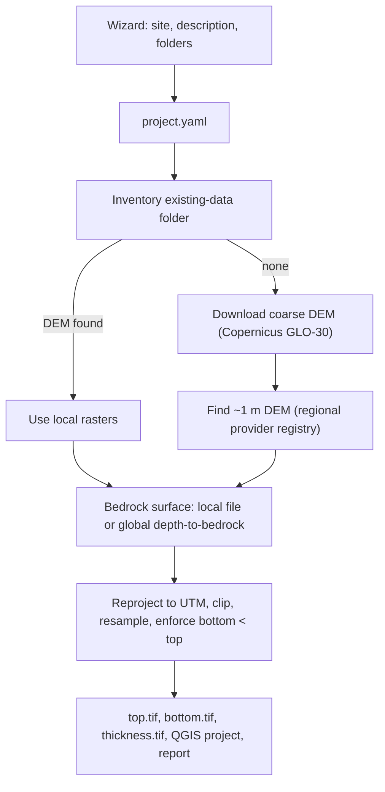

# Automated hydrogeological model setup (QGIS plugin)

## Recommended user interface

The recommended approach is a **QGIS Python plugin** with a multi-page wizard (`QWizard`, the Qt toolkit's step-by-step dialog that QGIS uses for its own interface). It is free and already installed with QGIS 3.44.15. It gives the user:
- A live map for picking the site. The plugin can use QGIS's built-in point-picking map tool (`QgsMapToolEmitPoint`) and extent selector (`QgsExtentGroupBox`), or accept typed latitude/longitude.
- Direct access to QGIS's processing tools, through either the `processing.run(...)` Python call or the `qgis_process` command line.
- Results loaded straight into a QGIS project, with no export/import step.

The processing logic will be kept separate from the user interface, so the same pipeline can also run headless with `python-qgis-ltr.bat project.yaml`.

## Location and structure

Code goes in a new folder, `Tools/qgis_mut_builder/`, following the existing `Tools/mut_document` and `Tools/mut_verify` packages:
- `plugin/`: QGIS plugin entry point (`metadata.txt`, `__init__.py`, `wizard.py`). It is installed into the QGIS plugins folder through a directory link created by `install_plugin.ps1`.
- `core/project.py`: reads and writes `project.yaml` (name, description, site latitude/longitude, regional and site buffer radii, data folder, output folder, chosen UTM projection code).
- `core/inventory.py`: scans the existing-data folder for rasters and vector files. It suggests files for each role (ground DEM, bedrock, boundary) using name hints and raster statistics. The user confirms the suggestions in the wizard.
- `core/providers/`: one module per data source, all sharing the interface `covers(bbox) -> bool` and `fetch(bbox, out_dir) -> path`.
- `core/pipeline.py`: the processing steps, which work identically in headless and plugin modes.
- `run_headless.py`: command-line entry point.

## Wizard pages

1. **Project:** name, free-text description of the system (aquifer type, purpose), and output folder.
2. **Site:** click a point on the map or type latitude/longitude. Set a regional buffer (default 20 km) and a site buffer (default 2 km). The UTM zone is filled in automatically and can be changed.
3. **Existing data:** choose a folder. A table shows the files found and their suggested roles, which the user can edit.
4. **Sources:** a checklist of download providers that cover the site, with an optional OpenTopography API key field.
5. **Run:** progress log. When finished, the outputs are added to the current QGIS project.

## Data sources

**Coarse ground surface (~30 m resolution, global):**
- Primary: **Copernicus GLO-30**, read from the public AWS bucket `copernicus-dem-30m` as cloud-optimized GeoTIFF tiles over HTTP (GDAL `/vsicurl/`). No account or key is needed. Tiles are mosaicked over the regional area.
- Fallbacks: NASADEM or SRTM GL1 through the OpenTopography global DEM API, which needs a free key.

**Fine ground surface (~1 m, where available), checked in order:**
- United States: USGS 3DEP 1 m, found through The National Map API.
- Canada: NRCan HRDEM (1–2 m), found through its STAC catalogue (a standard index of geospatial data).
- Europe: a small set of national lidar services (for example AHN in the Netherlands, the Danish DHM, the UK EA LIDAR), queried through their WCS map services where available.
- Anywhere: the OpenTopography lidar catalogue, searched by bounding box.
- If nothing covers the site, the run logs this clearly, keeps the 30 m surface as the top, and asks the user to drop a local file into the data folder.

**Bedrock surface:**
- A local file in the data folder takes priority (a bedrock elevation raster, or depth-to-bedrock with a unit flag).
- Global fallback: depth to bedrock from **Shangguan et al. (2017), 250 m**, downloaded from the SoilGrids file server. Bedrock elevation = ground surface DEM − depth to bedrock.
- The report states that this global product is coarse and uncertain, with errors of tens of metres in many areas, and should be replaced with local borehole-derived surfaces when they become available.

## Processing steps (`pipeline.py`)

- Assign and reproject everything to the project's UTM projection with `gdal:warpreproject`.
- Clip the coarse DEM to the regional extent and the fine DEM to the site extent with `gdal:cliprasterbyextent`.
- Merge the surfaces into one ground-surface top: fine DEM inside the site area, coarse DEM outside. Where they overlap, the fine DEM is resampled to the coarse grid and the two are blended across a short edge zone, so the model domain has no step at the boundary.
- Resample the bedrock surface to the top-surface grid. Then force bottom ≤ top − minimum thickness, using a configurable minimum thickness (default 1 m).
- Outputs written to `<output>/1_data/surfaces/`:
  - `ground_top.tif` and `bedrock_bottom.tif`
  - `surficial_thickness.tif` and `ground_top_site_1m.tif`
  - `sources.json`, recording where each file came from, its date, resolution and stated accuracy
- Write a `.qgz` QGIS project with these layers styled (hillshade for the top, a colour ramp for thickness), together with a Markdown run report.

## Documentation and tracking

- Add a "Automated model setup" section to [Docs/User's Guide/QGIS_Usage.tex](Docs/User's Guide/QGIS_Usage.tex) covering plugin installation, the wizard pages, the data sources and their accuracy caveats.
- Update [Docs/ai/PROGRESS.md](Docs/ai/PROGRESS.md).

## Out of scope for this first plan

- Producing `_build.mut` and mesh inputs from these surfaces (the next step).
- Deeper layers, boundary conditions and hydrogeological property assignment.